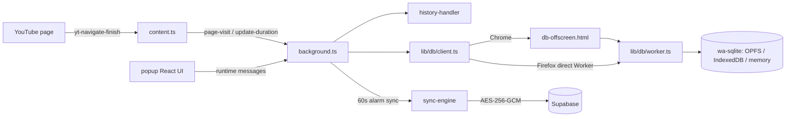

# Repository Guidelines

Browser extension (WXT + React 19 + TypeScript) that records YouTube browsing into a local wa-sqlite database and optionally syncs it encrypted across devices via Supabase. Targets Chrome MV3 (`.output/chrome-mv3`) and Firefox MV2 (`.output/firefox-mv2`, WXT's default for Firefox — MV3 only with an explicit `--mv3`/`manifestVersion: 3`).

## Architecture & Data Flow

- All popup/content → background traffic uses `{ type, data }` messages; the router replies `{ ok: true, data }` or `{ ok: false, error }`. Async cases must `return true`.
- Chrome hosts the SQLite worker in an offscreen document; Firefox spawns the Worker directly (no `offscreen` API). `lib/db/client.ts` abstracts both.
- VFS fallback order: OPFS (Chrome) → IndexedDB (Firefox/Safari) → memory. `getPersistenceMode()` surfaces this; the popup warns when `memory`.
- Local config (`device_id`, retention, pairing, license, migration flags) lives in the SQLite `device_config` table — not `browser.storage`.
- DB transport has its own envelope, `{ type: 'db-request', requestId, operation, params }` → `db-response`; it is handled by the offscreen doc/worker, not the background router.
- Adding a DB operation requires three edits: `DbOperation` + params in `lib/db/types.ts`, dispatch in `lib/db/worker.ts`, wrapper in `lib/db/client.ts`. `HISTORY_COLUMNS` in `worker.ts` mirrors `SELECT *` order and must stay aligned with `schema.ts`.
- The AES key is never persisted: it is re-derived (PBKDF2, fixed salt) from `device_config.pairing_code` on every sync, so changing the code makes existing remote rows undecryptable. `video_id` is not synced. Remote RLS is permissive for `anon`; confidentiality rests entirely on client-side encryption.

## Key Directories

| Path | Purpose |
|------|---------|
| `entrypoints/` | WXT entrypoints: `background.ts`, `content.ts`, `db-offscreen.html`, `popup/` |
| `lib/db/` | DB client, offscreen bridge, worker, SQL schema, cleanup, shared types |
| `lib/tracker/` | YouTube URL/page-type detection and metadata extraction |
| `lib/sync/` | Supabase client, pairing, push/pull engine, remote schema trigger |
| `lib/crypto/` | AES-256-GCM encryption, PBKDF2 key derivation from pairing code |
| `lib/licensing/` | LemonSqueezy license activation/validation |
| `lib/export/` | JSON/CSV export, JSON import |
| `supabase/` | Postgres migration + `setup-schema` Edge Function (mirrors local schema) |
| `public/_locales/` | Extension i18n (`__MSG_extName__`); keep all 7 locale files in sync |
| `mockup/` | Static HTML/PNG design references; not shipped |

## Development Commands

| Task | Command |
|------|---------|
| Install (also runs `wxt prepare`) | `bun install` |
| Dev, Chrome / Firefox | `bun run dev` / `bun run dev:firefox` |
| Build, Chrome / Firefox | `bun run build` / `bun run build:firefox` |
| Typecheck | `bun run compile` |
| Unit tests | `bun test` |
| Zip for stores | `bun run zip` / `bun run zip:firefox` |

Outputs: `.output/chrome-mv3/`, `.output/firefox-mv2/`. Load unpacked from there to verify UI.

## Code Conventions & Common Patterns

- Path alias `@/` → repo root (`@/lib/db/client`). Imports may include `.ts`; `verbatimModuleSyntax` is on, so use `import type` for types.
- TS is strict with `noUncheckedIndexedAccess`; indexed access yields `T | undefined`.
- Naming: camelCase functions/vars, PascalCase React components (`HistoryList.tsx`), kebab-case modules (`sync-engine.ts`), UPPER_SNAKE constants, snake_case SQL columns.
- Popup has no state library: local `useState` + `browser.runtime.sendMessage` in hooks (`useHistory.ts`); component CSS uses BEM classes and `--bg-*`/`--accent` variables in `App.css`.
- `lib/*` functions throw `Error`; the background router catches, logs `console.error('[area] ...')`, and returns `{ ok: false, error: String(err) }`. Follow this shape.
- DB calls go only through `lib/db/client.ts`; never talk to the worker directly from UI code. Client retries twice with a 15s timeout.
- SQL is assembled by string interpolation; values must pass `sqlValue()`/`escapeString()` in `lib/db/worker.ts`. Never concatenate raw user input.
- Schema changes must be applied in three places: `lib/db/schema.ts`, `supabase/migrations/001_initial_schema.sql`, and the statement list in `supabase/functions/setup-schema/index.ts`.
- Encrypted fields travel as JSONB `{ iv, ciphertext }`; keep plaintext columns limited to `id`, `group_id`, `device_id`, `page_type`, `visited_at`, `duration_seconds`.
- Build-time env vars are inlined from `.env`: `SUPABASE_URL`, `SUPABASE_ANON_KEY`, `LEMONSQUEEZY_STORE_ID`, `LEMONSQUEEZY_CHECKOUT_ID` (see `.env.example`). Only public/anon values belong here.
- Chrome-only APIs must be feature-guarded (`hasOffscreenAPI()`), and `wxt.config.ts` conditions permissions per browser target.

## Important Files

| Need | File |
|------|------|
| Message protocol / routing | `entrypoints/background.ts` |
| Navigation tracking | `entrypoints/content.ts`, `lib/tracker/youtube-tracker.ts` |
| Storage abstraction | `lib/db/client.ts`, `lib/db/worker.ts`, `lib/db/offscreen.ts` |
| Sync + pairing | `lib/sync/sync-engine.ts`, `lib/sync/pairing.ts` |
| Encryption | `lib/crypto/encrypt.ts`, `lib/crypto/key-derivation.ts` |
| Manifest/permissions/locales | `wxt.config.ts`, `public/_locales/` |
| User setup docs | `README.md` |

## Runtime/Tooling Preferences

- Use **Bun** (`bun.lock` is the only lockfile). Bun runs the scripts, but `wxt`/`tsc` are Node CLIs resolved from `node_modules/.bin`, so a Node runtime is still required. WXT is the only build tool, driven by Vite.
- Do not edit `.wxt/` or `.output/` — generated by `postinstall`/`build`.
- No linter or formatter is configured; match surrounding style.
- Sync cadence: push and pull every 60s via `browser.alarms` (service workers are suspended, so no `setInterval`); free tier caps a group at 3 devices (`FREE_DEVICE_LIMIT`).

## Testing & QA

- `bun test` runs the `tests/` suite (crypto, tracker, CSV escaping, import normalization, pull cursor). Add tests there with relative imports.
- Verify with `bun run compile`, `bun test`, then `bun run build` (`build:firefox` for Firefox-specific code), then load the built extension and exercise the popup/tracking path manually.
- CI (`.github/workflows/release.yml`) runs only on published releases: installs, typechecks, tests, writes `.env` from secrets, zips both targets, then publishes to Chrome Web Store/AMO with `continue-on-error`.
